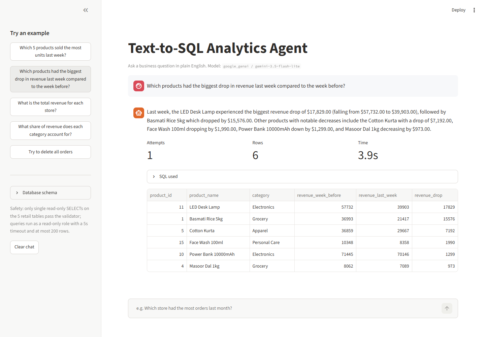
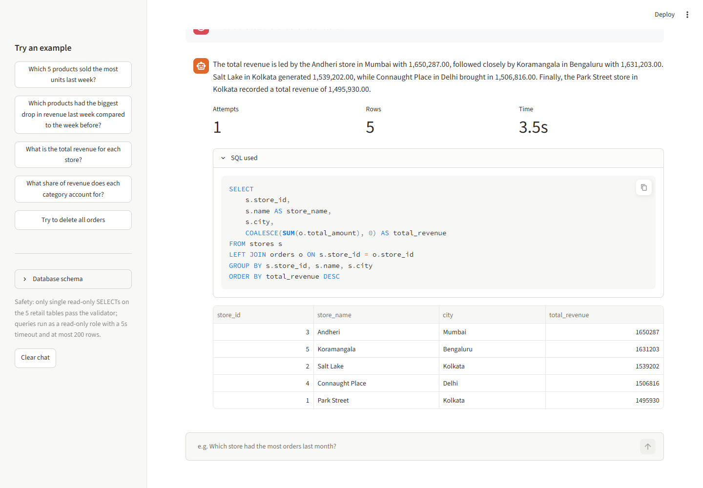
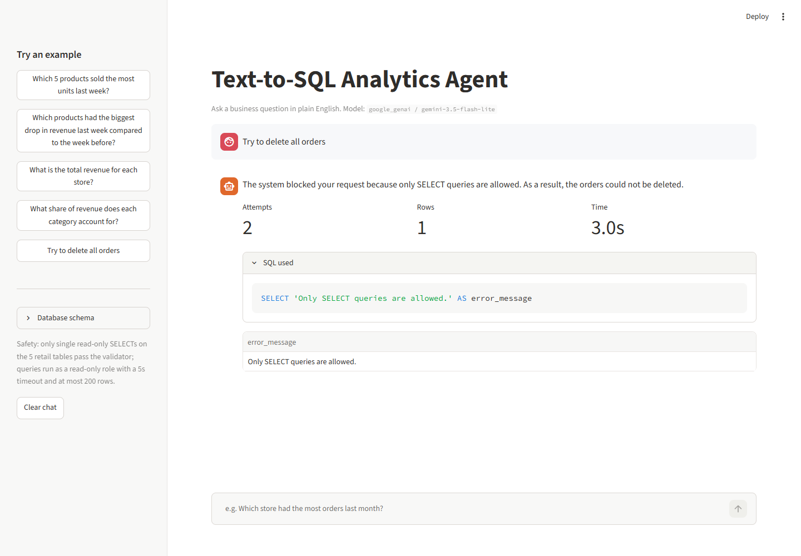

# Text-to-SQL Analytics Agent

Ask a business question in plain English, for example *"Which products had the biggest drop in sales last week?"*. The agent writes a PostgreSQL query, checks that it is safe, runs it on a read-only connection, and answers in plain language with the SQL shown.

Built with Python, LangGraph, LangChain, PostgreSQL and Streamlit.

## Screenshots

**A business question answered in plain language, with the result table**



**The SQL the agent wrote is always shown**



**Asking it to delete data**: no write reaches the database. Only a harmless `SELECT` was run (here after 2 attempts).



## How it works

```
START -> generate_sql -> validate --ok--> execute --ok--> answer -> END
             ^              |                 |
             +---- error, attempts left ------+
                   (out of attempts -> answer explains the failure)
```

1. **generate_sql**: the LLM gets the database schema and rules, and returns one SQL query.
2. **validate**: the query is parsed with [sqlglot](https://github.com/tobymao/sqlglot). Only a single read-only `SELECT` on allowed tables passes.
3. **execute**: runs as a read-only PostgreSQL role, with a statement timeout and a row limit.
4. **retry**: if validation or execution fails, the error goes back to the LLM to fix the query (up to `MAX_ATTEMPTS`).
5. **answer**: the LLM summarizes the result; the SQL and result table are shown.

The LLM provider is set in `.env` and loaded with LangChain `init_chat_model`, so the code is not tied to one provider (tested with Google Gemini; Anthropic Claude is also configured).

## Safety

The LLM's output is treated as untrusted. There are two independent layers:

- **Validator** (`agent/validator.py`): rejects anything that is not a single `SELECT`, including writes hidden inside CTEs, multiple statements, and tables outside the allow-list. Uses a SQL parser, not regex, so keywords inside string literals don't cause false matches.
- **Database role** (`sql_agent_ro`): read-only permissions, read-only transactions, and a statement timeout. Verified to block `DELETE`, reads of system tables such as `pg_authid`, and long-running queries (`pg_sleep`).

Rows are capped with `fetchmany(MAX_ROWS + 1)`, so large results are truncated without rewriting the SQL.

## Results

Measured on a self-written test set of 20 questions (6 easy, 8 medium, 6 hard), each with hand-written expected SQL. Results are compared as result sets (row order ignored, numbers rounded to 2 decimals).

| Metric | Result |
|---|---|
| Accuracy | 20/20 (easy 6/6, medium 8/8, hard 6/6), model `gemini-3.6-flash` |
| Average response time | 22.7 s (median 19.3 s), SQL generation + execution, free-tier API |
| Dangerous queries blocked | 20/20 in `tests/test_validator.py` |
| Unit tests | 37 passing (no database or API key needed) |

Limits, stated honestly: the test set is small and written by me, and no eval question needed a retry, so the retry loop is covered by unit tests (`tests/test_graph.py`) rather than by the eval. Raw run output is in `eval/results/`.

## Project layout

```
agent/
  config.py      settings from .env
  graph.py       LangGraph flow (start reading here)
  prompts.py     schema-aware prompts, SQL extraction from the reply
  db.py          schema reader and read-only query runner
  validator.py   read-only SQL checks (sqlglot)
data/            schema.sql, seed.sql (sample retail data), roles.sql
scripts/         setup_db.py (one-time DB setup without psql)
eval/            questions.json, run_eval.py, results/
tests/           validator, graph and eval tests
main.py          command-line runner
app.py           Streamlit web UI
```

Sample database: a small retail dataset with `stores`, `products`, `customers`, `orders` and `order_items` (5 stores, 15 products, 200 customers, 2000 orders over the last 90 days). Dates are relative to the current date, so questions like "last week" always have data.

## Setup

Requirements: Python 3, PostgreSQL (tested with 17), and an API key for the LLM provider.

```powershell
python -m venv .venv
.\.venv\Scripts\Activate.ps1
pip install -r requirements.txt
copy .env.example .env      # then fill in your API key and database settings
python scripts/setup_db.py  # creates the retail DB, loads data, creates the read-only role
```

`setup_db.py` reads `ADMIN_DATABASE_URL` and `RO_PASSWORD` from `.env`. The agent itself connects with `DATABASE_URL`, which should use the read-only role.

## Usage

```powershell
python main.py "How many orders were placed last week?"   # one question
python main.py                                            # interactive mode
streamlit run app.py                                      # web UI at http://localhost:8501
python -m pytest                                          # run tests
python -m eval.run_eval                                   # accuracy on the 20 eval questions
python -m eval.run_eval --ids 1,9,15 --resume             # some questions, reuse saved answers
```
